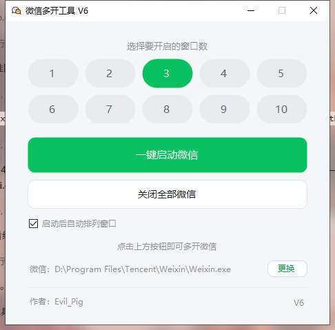

# 微信多开工具（WeChatMulti）

一键同时启动多个微信 4.x Windows 客户端实例，每个实例拥有独立的登录态与数据目录。



- **目标框架**：.NET Framework 4.8（Windows 10/11 自带，**无需安装任何运行时**）
- **平台**：Windows x64
- **最大实例数**：10
- **当前版本**：V6

---

## 功能

| 功能 | 说明 |
| --- | --- |
| 一键多开 | 选择 1~10 个窗口，点「一键启动微信」并发拉起对应数量的实例 |
| 自动排列窗口 | 启动后把各实例窗口按网格 / 层叠排布，一眼看清全部 |
| 关闭全部微信 | 一次性结束所有微信进程（含子进程） |
| 自动探测微信 | 读注册表 + 扫描常见安装目录，自动定位 `Weixin.exe` / `WeChat.exe` |
| 手动指定路径 | 探测不到时可手动指定，路径会被记住，下次启动直接使用 |
| 命令行模式 | `--launch N` 可直接拉起 N 个实例，适合挂桌面快捷方式 |

---

## 使用

### 图形界面

1. 下载 `release/WeChatMulti.exe`，双击运行。
2. 点选要开启的窗口数（例如 3）。
3. 点「一键启动微信」。

> 首次运行会自动探测本机微信安装位置。若探测失败，点界面底部微信路径右侧的「更换」手动指定 `Weixin.exe` / `WeChat.exe`。

### 命令行

```cmd
WeChatMulti.exe --launch 5
```

拉起 5 个实例，并在启动后自动按网格排列窗口：

```cmd
WeChatMulti.exe --launch 5 --arrange grid
```

按层叠方式排列：

```cmd
WeChatMulti.exe --launch 5 --arrange cascade
```

手动指定微信路径（指定后会被记住）：

```cmd
WeChatMulti.exe --launch 3 --path "D:\Program Files\Tencent\Weixin\Weixin.exe"
```

| 参数 | 取值 | 说明 |
| --- | --- | --- |
| `--launch N` | 1 ~ 10 | 目标实例数 |
| `--arrange mode` | `grid` / `cascade` | 网格平铺 / 层叠排列 |
| `--path <路径>` | exe 或目录 | 手动指定微信主程序位置 |

退出码：`0` 成功、`1` 未达到目标实例数、`2` 未检测到微信安装。

---

## 实现原理

### 1. 多开靠的是「竞态窗口」

微信 4.x 的单实例检查与互斥体创建之间存在时间差：当多个进程在**同一瞬间**启动时，它们会在彼此拿到互斥体之前全部通过检查，于是各自成为一个独立实例。微信随后自动为每个实例分配 `net`、`net_1` … `net_9` 这样的独立数据目录，登录态与聊天记录天然隔离。

所以这个工具的关键不是「反复尝试启动」，而是**把启动间隔压到足够小**。

### 2. 用原生 `CreateProcessW` 抢时间窗

`Process.Start` 每次调用都要拼 `ProcessStartInfo`、解析路径、构造 `Process` 对象并打开句柄，单次开销十几毫秒。N 个实例的突发间隔被拉长后，先启动的进程会抢先拿到互斥体，后面的全被挡回去。

直接调用 Win32 `CreateProcessW` 后单次开销约 **2~3 毫秒**，突发足够紧凑（见 `Core/FastLauncher.cs`）。

启动前还会用一个无害的 `cmd.exe /c exit` 预热 JIT 与系统调用路径 —— 注意绝不能拿微信本身预热，那会真的多出一个实例。

### 3. 数量不对时是「先清空、再齐发」，不是补开缺口

已经运行的实例会一直占着互斥体，后来者根本挤不进竞争窗口。所以当数量不够时，工具会先关掉全部现有实例、确认互斥体彻底释放（连续两次读到 0），再让 N 个实例同时起跑，最多重试 3 轮（见 `Core/InstanceManager.cs`）。

---

## 从源码编译

需要 [.NET SDK](https://dotnet.microsoft.com/download)（用于还原与构建）以及 .NET Framework 4.8 目标包。

```cmd
git clone https://github.com/mypc1995/WeChatMulti.git
cd WeChatMulti
dotnet build WeChatMulti.sln -c Release
```

单独构建主程序并输出到 `release/`：

```cmd
dotnet publish WeChatMulti\WeChatMulti.csproj -c Release -f net48 -o release
```

生成的可执行文件是 `release/WeChatMulti.exe`，单文件运行，无需附带任何依赖。

### 冒烟测试

`WeChatMulti.Smoke` 会真实拉起实例并核对数量（会实际启动/关闭本机微信，仅供开发调试）：

```cmd
dotnet run --project WeChatMulti.Smoke -- 3 5 10
```

### 界面截图工具

`WeChatMulti.Preview` 把界面按真实屏幕渲染成 PNG：

```cmd
dotnet run --project WeChatMulti.Preview -- preview.png
```

---

## 项目结构

```
WeChatMulti.sln
├─ WeChatMulti/            主程序（WinForms 界面 + 核心逻辑）
│  ├─ MainForm.cs          界面与交互
│  ├─ Program.cs           入口：命令行模式 / 图形模式分发
│  ├─ Core/
│  │  ├─ CliRunner.cs      命令行模式
│  │  ├─ FastLauncher.cs   原生 CreateProcessW 启动器
│  │  ├─ InstanceManager.cs 实例数量管理（清空 / 齐发 / 重试）
│  │  ├─ WeChatLocator.cs  微信安装位置探测
│  │  └─ WindowArranger.cs 窗口网格 / 层叠排列
│  └─ Ui/                  自绘控件（ChipSelector、FlatButton）
├─ WeChatMulti.Preview/    开发用：界面渲染截图
├─ WeChatMulti.Smoke/      开发用：多开冒烟测试
└─ release/                可直接下载运行的 Windows 可执行文件
```

---

## 说明与声明

- 本工具利用的是微信自身单实例检查中的竞态窗口，属于对客户端行为的技术性调用。
- 多开可能违反微信用户服务协议，请仅在个人学习与测试场景下使用，风险自负。
- 每个实例使用独立的数据目录，**多开账号之间互不可见**，请自行注意账号安全。
- 作者：Evil_Pig
